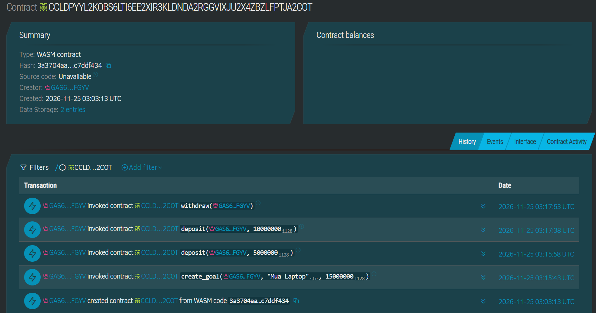

# Project Title

**SavingGoal** — On-Chain Savings Goal Tracker on Stellar (Soroban)

## Project Description

SavingGoal is a Stellar Soroban smart contract designed to help students build disciplined saving habits for personal targets, such as buying a laptop. Each user can create one active savings goal with a target amount, record incremental deposits on-chain, and withdraw only after the saved amount reaches or exceeds the target. Anyone can view a user's savings progress, while only the goal owner can create, deposit into, or withdraw from their own goal.

## Project Vision

Many students struggle to stay consistent with personal savings and often spend their money before reaching their goal. SavingGoal brings transparency and strict on-chain rule enforcement to personal saving, encouraging users to stay committed until their target amount is fully met.

## Key Features

- **Create a Savings Goal (`create_goal`)**: Authenticated users can create a goal with a custom name and a positive `target_amount`. The contract records the creation timestamp (`created_at`) from the ledger and enforces a limit of one active (unwithdrawn) goal per user.
- **Record Deposits (`deposit`)**: Authenticated users can add positive amounts to their active goal, with overflow protection using checked arithmetic.
- **Target-Locked Withdrawal (`withdraw`)**: Authenticated users can withdraw their full `saved_amount` only when `saved_amount` is greater than or equal to `target_amount`. Early withdrawals are rejected with `GoalNotReached`. Once withdrawn, the goal is marked as completed (`withdrawn = true`), allowing the user to start a new goal later.
- **Public Progress Tracking (`get_goal`)**: Anyone can query a user's address to view their goal name, target amount, saved amount, withdrawal status, and creation timestamp.
- **Access Control & Structured Error Handling**: All state-changing functions require owner authorization (`require_auth()`). Invalid actions return explicit contract errors (`GoalAlreadyExists`, `GoalNotFound`, `InvalidAmount`, `GoalAlreadyWithdrawn`, `GoalNotReached`, `AmountOverflow`).

## Usage Instructions

### Prerequisites
- Rust and Cargo installed
- Stellar CLI installed
- A funded Stellar Testnet account (e.g., `student`)

### Build the Contract
```powershell
stellar contract build
```

### Invoke Functions on Testnet (Windows PowerShell)

1. **Create a new savings goal:**
```powershell
stellar contract invoke --id my-contract --source-account student --network testnet -- create_goal --user student --name "Mua Laptop" --target_amount 15000000
```

2. **Deposit into the goal:**
```powershell
stellar contract invoke --id my-contract --source-account student --network testnet -- deposit --user student --amount 5000000
```

3. **View goal progress:**
```powershell
stellar contract invoke --id my-contract --source-account student --network testnet -- get_goal --user student
```

4. **Deposit the remaining amount to reach the target:**
```powershell
stellar contract invoke --id my-contract --source-account student --network testnet -- deposit --user student --amount 10000000
```

5. **Withdraw after reaching the target:**
```powershell
stellar contract invoke --id my-contract --source-account student --network testnet -- withdraw --user student
```

## Future Scope

- **Real Token Custody (Stellar Asset Contract Integration)**: Lock actual XLM or USDC tokens inside the contract rather than tracking balances as ledger records only.
- **Multiple Concurrent Goals**: Allow a single user to create and manage multiple savings goals at the same time.
- **Target Deadlines**: Add optional target completion dates and time-based lock rules.
- **Emergency Withdrawal with Penalty**: Support early withdrawals with a configurable penalty fee or accountability partner approval.
- **Web Frontend (dApp)**: Build a web interface integrated with Freighter Wallet so users can interact with the contract without using the CLI.

## Technology Stack

- **Blockchain**: Stellar (Soroban Testnet)
- **Smart Contract Language**: Rust (`#![no_std]`)
- **SDK**: `soroban-sdk` v29
- **CLI & Deployment**: Stellar CLI

## Contract Detail

- **Contract ID**: `CCLDPYYL2KOBS6LTI6EE2XIR3KLDNDA2RGGVIXJU2X4ZBZLFPTJA2COT`
- **Deployer**: `GAS64G5YIF3VHCFFXTSUDTUTEYJJXYQ5LWYXGRDNRQ2TQW5TNDDNFGYV`

